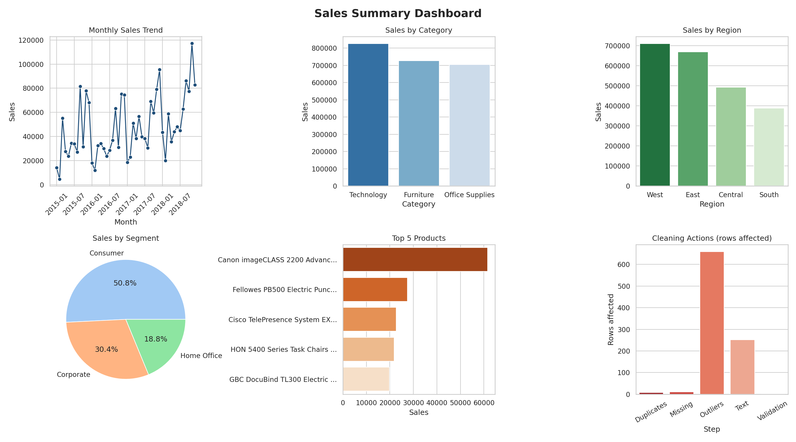

# Data Cleaning & Reporting Automation

A Python script that automatically cleans a raw sales dataset and generates an Excel report and a visual dashboard with one command.

## Problem Statement
Manual data cleaning and reporting is slow and error-prone. This project automates the workflow: handle missing values, duplicates and inconsistent data, then produce reports and visual summaries.

## Dataset
Superstore Sales (`train.csv`): 9,800 rows, 18 columns, orders from Jan 2015 to Dec 2018.

## Features
- **Missing values**: Postal Code blanks filled using other rows with the same City and State
- **Duplicates**: removes fully duplicated rows and repeated Order ID + Product ID lines
- **Inconsistent data**: trims extra spaces, standardises category text, converts text dates to real dates
- **Validation**: checks that Ship Date is not before Order Date
- **Outliers**: flagged in a `Sales Outlier` column (not deleted)
- **Cleaning log**: every action and the number of affected rows is recorded
- **Automated Excel report** with 8 sheets and built-in charts
- **Dashboard image** (seaborn + matplotlib)

## Project Files
| File | Purpose |
|---|---|
| `auto_clean_report.py` | Main automation script |
| `train.csv` | Raw dataset |
| `report_output/cleaned_data.csv` | Cleaned dataset |
| `report_output/Sales_Report.xlsx` | Excel report (Summary, Cleaning Log, By Category, By Region, By Segment, Yearly, Monthly Trend, Top 10 Products) |
| `report_output/dashboard.png` | Visual summary |
| `Data_Cleaning_Automation_Report.docx` | Project report |

## How to Run
```
pip install pandas numpy matplotlib seaborn openpyxl
python auto_clean_report.py
```
To use another CSV file:
```
python auto_clean_report.py yourfile.csv
```

## Results
| Step | Issue | Rows |
|---|---|---|
| Text | Extra spaces trimmed | 251 |
| Dates | Text converted to datetime | 9,800 |
| Duplicates | Exact duplicates removed | 1 |
| Duplicates | Repeated order lines removed | 7 |
| Missing | Postal Code filled | 11 |
| Outliers | Flagged (kept) | 659 |

Rows: **9,800 before, 9,792 after cleaning**.

Report highlights: total sales 2,259,845.49; top category Technology; top region West; yearly growth +30.5% (2017) and +20.3% (2018).

## Dashboard


## Future Improvements
- Schedule daily runs with Windows Task Scheduler
- Email the report automatically
- Connect `cleaned_data.csv` to Power BI

## Tools
Python, pandas, NumPy, openpyxl, matplotlib, seaborn
